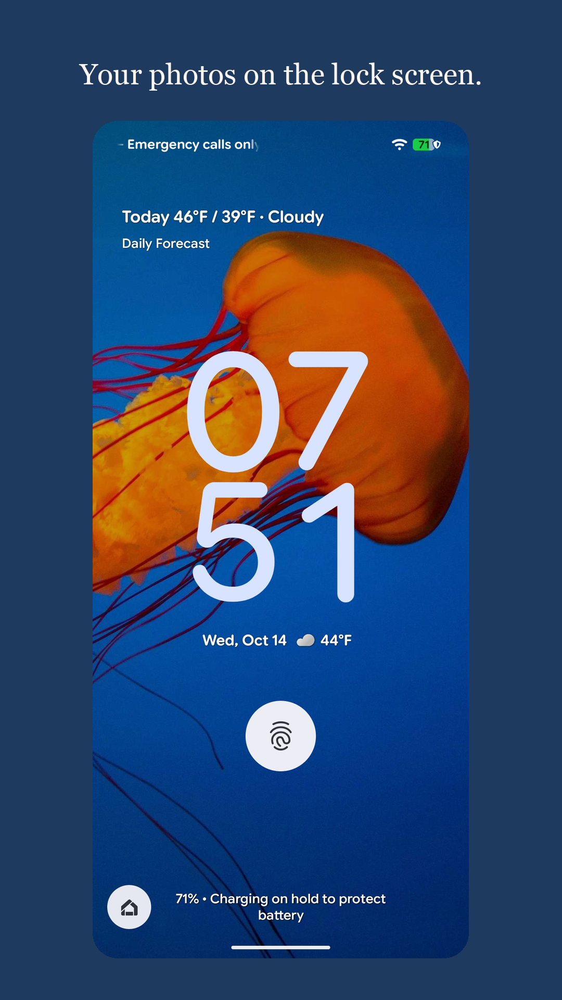
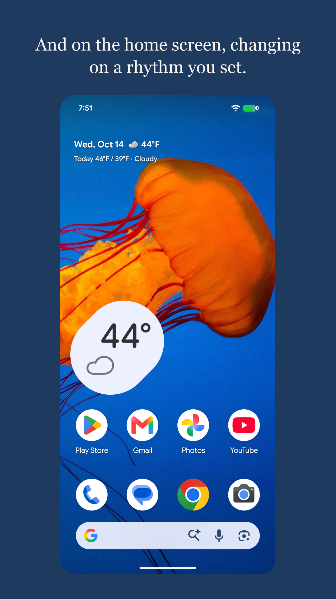
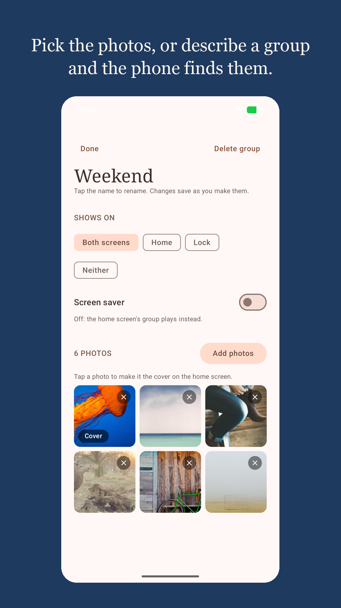

# Feels Engine

Built to see photos of my kids on my phone.

A local first android app that turns a group of photos into a wallpaper, lock screen and screen saver. Pick photos, or describe a group ("the kids at the beach") and the phone finds them.

## Screenshots

| Lock screen | Home screen | A group |
|---|---|---|
|  |  |  |

Taken on a Pixel 8 and a Pixel 8 emulator with demo photos from picsum.photos. On a tablet the same page widens to six columns: `docs/screenshots/6-tablet.png`.

## Install

Requires JDK 17 or newer and the Android SDK (compileSdk 37). No Android Studio needed.

```bash
./gradlew :app:assembleDebug
adb install -r app/build/outputs/apk/debug/app-debug.apk
```

Minimum Android 9 (API 28). Gemini Nano judging needs a phone on Google's Prompt API device list with Google AICore installed; elsewhere described groups match on ML Kit labels alone.

## Use

1. Open the app. Tap New group, then Pick photos or Describe it.
2. Choose which screen the group shows on: home, lock, both, or the screen saver switch.
3. Set the rhythm: every so often (15 minutes to a day) or at set times.
4. Turn rotation on. Change now applies the next photo immediately.

A described group looks through the photos on the phone and the ones you add from the picker. Matches get a Found badge; tap X to keep one out for good. The screen saver plays under Settings > Display > Screen saver once Feels Engine is chosen there.

## Layout

- `app/src/main/kotlin/dev/fengine/wallpaper/`: the app. `ui/` screens and the
  design language, `data/` settings and groups, `schedule/` rotation,
  `wallpaper/` crop and apply, `smart/` described groups, `screensaver/` the
  DreamService.
- `app/src/test/`: JUnit examples and jqwik invariant properties.
- `docs/`: architecture, build, privacy, design system, research.
- `AGENTS.md`, `CLAUDE.md`: how agents work in this repo.

## Build and test

```bash
./gradlew :app:testDebugUnitTest   # unit tests + properties
./gradlew :app:lintDebug
```

CI runs both plus a debug build on every push. Tagged releases carry a signed APK; see `docs/release.md` and the Releases page.

Device notes, including Samsung foldables and the screen saver preview, are in `docs/build.md`.

## Limits

- The system photo picker hands over at most 100 photos per pick, and Android keeps at most 512 picked photos readable per app. A large library has to be on the phone; see `docs/privacy.md` and the audit.
- Described groups without Gemini Nano match label words, not meaning.
- The app cannot read the current wallpaper back on Android 14+, so a rotation cannot be undone from inside the app.

## Website and privacy policy

https://trvon.github.io/feels-engine/ is the landing page; the privacy policy is at https://trvon.github.io/feels-engine/privacy.html. Both are built from `site/` by the Pages workflow.

## Documentation

`docs/index.md` lists everything. Start with `docs/architecture.md` and
`docs/research/android-wallpaper-audit.md`.

## License

Apache License 2.0. See `LICENSE` and `NOTICE`.
